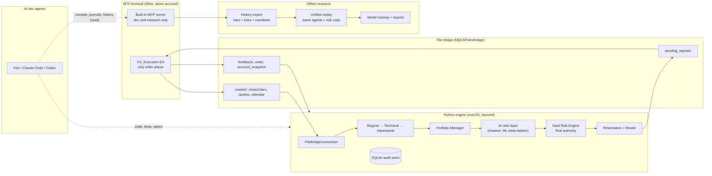

# Full development plan: from prototype to demo-validated system, with AI

> **Progress 2026-11-04.** Phases 0 and 1 are done except burn-in; Phase 2 produced replay evidence and gate G2 **failed** (no edge); Phase 4 builds S1 and S2 are done; the validation tooling (R1 to R10) is built. Phase 6 (30-day demo) is superseded by ADR 0007. The next required work is Phase 2b (strategy redesign). Live status: `docs/STATUS.md`. Detail: `fx_ai_engine/docs/2026-11-04-system-capability-and-readiness.md`.

Date: 2026-11-03. Builds on `docs/2026-11-03-system-assessment-and-benchmark.md` and `docs/plans/2026-11-02-system-build-roadmap.md`. Durations are estimates for one owner working with AI agents part-time. They are not commitments.

---

## 1. What "complete" means for v1

The system is complete for v1 when all of the following are true and the evidence is stored in the repository:

1. The engine runs unattended on the demo account, reads market data, makes decisions, and the EA executes them. Every routed signal reaches a recorded terminal state.
2. Restarts, stale data, rejected orders, and partial fills fail closed. Each has a tested recovery procedure.
3. A reproducible replay of at least 3 years of history, using the same decision and risk code as live, shows positive expectancy after costs on held-out data.
4. A frozen configuration passes the revised SRS acceptance gates on a 30-day forward demo.
5. Any AI component is either in shadow mode with logged evidence, or promoted through a documented gate. No AI component can open a trade, size a trade, or loosen a risk limit.

Real money is out of scope for v1 completion. It is a separate decision after step 4 (Phase 7).

---

## 2. New finding that changes the plan

The MT5 terminal on this Mac (build 6296) already runs MetaQuotes' built-in MCP server. The terminal log shows `MCP started on 127.0.0.1:22346`, and a request from macOS to that address returns `401`, meaning it is reachable and requires an API key. MetaQuotes added this in [build 6060 (July 2026)](https://www.metaquotes.com/en/metatrader5/news/5538).

Per the [MT5 MCP tool list](https://www.metatrader5.com/en/terminal/help/mcp_and_ai/capabilities), the servers expose:

| Server | Useful tools for us | Risk |
| --- | --- | --- |
| terminal (`:22346`) | `get_chart_history`, `get_chart_ticks_history` (bid/ask ticks), account, positions, order and deal history, expert and terminal journals, Strategy Tester (`tester_run_backtest`, `tester_get_report`), economic calendar | Also exposes `trade_send_market_order` and other trade tools |
| metaeditor (`:22345`, runs only while MetaEditor is open) | `compile_file`, `syntax_check`, file read/write in the MQL5 folder | Can edit and delete MQL5 files |
| marketdata (MetaQuotes cloud) | News, calendar, 1h+ bars | Not broker data |

What this enables:

- **AI dev agents can verify MT5 work directly.** Kiro, Claude Code, and Codex can compile the EA, read the experts journal, and check account and deal history without you copying logs by hand.
- **Research data on the Mac.** Tick and bar history can be exported for replay without the Windows-only Python package.
- **Broker-native calendar.** The terminal's economic calendar can feed the market-context gate, which keeps the SRS "MT5 feed only" rule.

What it must not be used for: placing orders. The EA stays the only component that trades. Section 5.3 covers how to enforce this.

I recommend MCP for development, research and verification, and **not** as the live engine's market-data feed. It is designed for interactive agents, MetaQuotes publishes no reliability guarantees for it, and it adds a network/auth dependency on the trading path. The live feed should come from the EA through the existing file bridge (Build I1).

---

## 3. Decisions needed from you

Each item has a recommended default. Phases that depend on an item are listed so work can start on the rest.

| # | Decision | Recommended default | Blocks |
| --- | --- | --- | --- |
| D1 | Broker and account type you intend to fund | Undecided is fine until Phase 7. If known, open that broker's demo now and use it for Phase 6 | Phase 6 environment, Phase 7 |
| D2 | Meaning of "average R" in SRS §12.2 | Replace with: expectancy ≥ +0.25R per trade after costs, profit factor ≥ 1.3, average winner ≥ 1.5R | Phase 3, Phase 6 |
| D3 | Risk per trade during the 30-day demo | Keep 3.2% only if Phase 2 shows the drawdown gate is reachable; otherwise lower to 1.0–1.5% via SRS v1.1 | Phase 3 |
| D4 | Live market-data path | EA exports closed bars to the file bridge (Build I1) | Phase 1 |
| D5 | Host for the 30-day demo | This Mac with sleep disabled and launchd supervision. A Windows VPS is required before real money | Phase 1 (I7), Phase 6 |
| D6 | Scope of AI inside the running system | v1: shadow only. Promotion later, and only for components that can reduce or veto risk | Phase 5, SRS v1.1 |
| D7 | LLM provider for in-system AI experiments | Your existing Anthropic or OpenAI key for offline jobs. MT5's built-in assistant with Trading set to "not trade at all" | Phase 5 |
| D8 | Commit the 13 uncommitted files now | Yes, to a branch `hardening/2026-11`, then push | Phase 0 |

SRS v1 §3 item 7 says "LLM usage: Disabled in v1" and §13 lists LLM reasoning as out of scope. Any runtime LLM use therefore needs an SRS v1.x change first. LLMs used to build the system (Kiro, Claude, Codex) are not affected.

---

## 4. Target architecture

Invariants that must hold in every phase, each backed by a test:

1. Only the EA sends orders. No Python process and no AI agent calls an MT5 trade function.
2. The Hard Risk Engine runs after every other component, including any AI component.
3. An AI component's output can only keep or reduce `final_risk_percent`, or reject. It can never approve something the rules rejected.
4. Live and replay call the same decision and risk functions.
5. Uncertain execution keeps risk reserved until broker evidence resolves it.

---

## 5. AI in this project: two separate tracks

### 5.1 Track A: AI inside the trading system

Published evidence points one way. A [2026 survey of 47 LLM trading systems](https://yebof.github.io/assets/pdf/feng2026algorithms.pdf) found that independently re-run LLM agents lose most or all of their reported advantage. Its best-supported design keeps the LLM upstream of the trade, producing text signals, code or research. A rule-based system makes, sizes and executes the trade. A [Georgia Tech review](https://arxiv.org/html/2603.27539) lists look-ahead bias, cost neglect and single-regime testing as failures that can reverse the sign of reported returns. LLMs also recall historical prices from training data, so a backtest over dates before the model's training cutoff is not valid evidence. Only forward (live or shadow) evaluation is.

This project's design already matches that evidence: deterministic rules decide, and a hard risk engine has the final say. AI is added around that core, in this order:

| Tier | Component | Role | Can it affect trades? | Evaluation method | Earliest phase |
| --- | --- | --- | --- | --- | --- |
| A0 | Deterministic agents (existing) | Make every trade decision | Yes, through the risk engine | Replay + forward demo | Now |
| A1 | ML meta-labeler (exists in `ml/meta_labeler/`) | Estimate probability that a rule signal wins; can veto or scale risk down | Shadow in v1. After promotion: veto or reduce only | Purged walk-forward on replay candidates, then forward shadow comparison | Phase 5 |
| A2 | LLM operations copilot | Daily report, explain halts, triage reconciliation, read MT5 journals via MCP read tools | No. Read-only, a human acts | Usefulness review by you | Phase 4–5 |
| A3 | LLM event-risk classifier | Read calendar and headlines, output `normal / reduce / block` per currency | Shadow in v1. After promotion: reduce or block only | Forward only, because of training-data contamination | Phase 5 |
| A4 | LLM research assistant | Propose hypotheses, write experiment configs, read replay reports | No. Changes go through the experiment registry and your approval | Every variant logged; multiple-testing correction | Phase 2 onward |
| Not allowed | LLM as trader, sizer or risk engine | — | — | — | Never in v1 |

Rules for any component that touches the decision path:

1. Its output is a typed value (`veto: bool`, `risk_multiplier ∈ [0, 1]`, `reason_code`), never free text that code parses.
2. It has a timeout and a default. If it fails, the trade proceeds with the deterministic decision (shadow) or is blocked (once promoted). Which one is set per component and recorded in the SRS.
3. Every call is logged with inputs, model ID, prompt or model version, output, and latency, so results can be reproduced and audited.
4. Promotion needs: at least 100 forward shadow decisions; a measured improvement in expectancy or drawdown against the same signals without the AI; no increase in hard-risk events; and your written approval.

### 5.2 Track B: AI in building the system (Kiro, Claude Code, Codex)

Claude Code and Codex are installed on this Mac (`~/.local/bin/claude`, `~/.local/bin/codex`). The repo has Copilot instructions, but `copilot-instructions.md` refers to a `CLAUDE.md` that does not exist, and there is no `.kiro/` configuration. Three tools reading three different instruction sets will drift.

**One source of truth for agent instructions**

- Create `AGENTS.md` at the repo root as the canonical file (Codex reads it natively). It holds the architecture, invariants, locked constants, commands, and evidence rules.
- `CLAUDE.md` becomes one line that imports `AGENTS.md` (`@AGENTS.md`).
- `.kiro/steering/project.md` includes it with `#[[file:AGENTS.md]]`. Add a `fileMatch` steering file for `core/risk/**`, `mt5_ea/**` and `bridge/**` carrying the guardrails now in `.github/instructions/`.
- `.github/copilot-instructions.md` points to `AGENTS.md`.

**Who does what**

| Work | Tool | Why |
| --- | --- | --- |
| Specs (requirements → design → tasks) per build, orchestration, workflows | Kiro | Spec sessions and review loops are built in |
| Implementation of a well-specified task | Kiro, Claude Code, or Codex | Interchangeable once the spec is clear |
| Independent review of safety-critical diffs | A different model from the one that wrote the code | Reduces shared blind spots |
| EA compile, journal reading, demo evidence collection | Any agent with the MT5 MCP connection | Removes manual copy-paste |
| Decisions, approvals, merges, anything touching risk limits | You | Accountability stays with the owner |

**Working rules for agents**

1. One branch or git worktree per task. Two agents never edit the same file area at the same time; `main.py` and `database/db.py` in particular get one owner per change.
2. Every task states its acceptance check, and the agent reports the command output that proves it. "Tests pass" without output does not count.
3. Changes to `core/risk/**`, `config_microcapital.py`, `SRS_v1.md`, or `mt5_ea/**` require a second-model review and your approval before merge.
4. Decisions are recorded as short ADRs in `docs/decisions/` so later sessions of any tool see the same history.
5. Agents do not run `--mode demo` or touch the bridge folder of the live terminal unless the task explicitly says so.

### 5.3 Making the MT5 MCP safe for agents

1. In MT5 **Tools → Options → AI Assistant**, set **Trading** to "not trade at all", **Web** to off, and leave **Dangerous shell operations** disabled.
2. In **Tools → Options → MCP**, generate the API key and store it as an environment variable (for example `MT5_MCP_TOKEN`). Put it only in user-level agent config (`~/.kiro/settings/mcp.json`, `~/.claude.json`, `~/.codex/config.toml`), never in the tracked `.mcp.json`.
3. Add a Kiro `PreToolUse` hook that blocks any MCP tool whose name starts with `trade_` (exit code 2). Configure the equivalent deny rule in Claude Code and Codex.
4. Treat MCP output (journals, news, calendar text) as data, not instructions.

The tracked `.mcp.json` currently points the SQLite server at a Windows/WSL path (`/mnt/c/Users/rayng/...`) that does not exist on this Mac. Update it to a relative or user-level path in Phase 0.

---

## 6. Phased roadmap

Each build gets its own Kiro spec. Gates (G0 to G6) must pass before the next phase starts. Phases 4 and 5 run alongside 2 and 3.

### Phase 0: Foundation and governance (2–3 days)

| Build | Deliverable | Acceptance check |
| --- | --- | --- |
| F1 | Commit current work to `hardening/2026-11` and push (D8) | `git status` clean on the branch; remote shows the commit |
| F2 | Recreate `.venv` on Python 3.12 (inside the stated 3.11–3.13 range) with pinned runtime and research lock files | Suite passes in the new venv |
| F3 | GitHub Actions CI: tests on 3.11 and 3.13 with `USE_MT5_MOCK=1`; a check that locked constants in `config_microcapital.py` match the SRS table | Green run on the branch |
| F4 | `AGENTS.md`, `CLAUDE.md` pointer, `.kiro/steering/`, updated Copilot pointer, `docs/decisions/` | Each tool, asked "what are the locked risk limits?", answers from the same file |
| F5 | Kiro hooks: block `trade_*` MCP tools; ask before edits to protected paths; run tests after spec tasks | Hook fires in a dry test |
| F6 | MT5 MCP connected read-only for Kiro, Claude Code, Codex (Section 5.3); MetaEditor open so `:22345` is up | Agent reads `get_trading_account_info` and compiles the EA through `compile_file` |
| F7 | Fix `.mcp.json` SQLite path | Server starts on this Mac |

**G0:** CI green, agents share instructions, MT5 MCP reachable with trade tools blocked.

### Phase 1: First real trades on the demo account (1–2 weeks)

| Build | Deliverable | Acceptance check |
| --- | --- | --- |
| I1 | EA writes closed bars (`CopyRates` from shift 1, about 400 bars) for 6 pairs × M15/H1/H4/D1 to `bridge/market/`, with schema version, UTC timestamps and the server-time offset. New `FileBridgeConnection` in Python implements the same interface as `MT5Connection` and fails closed on stale or malformed files | Contract tests pass against both mock and file-bridge implementations; live files refresh within 30 s of each M15 close |
| I2 | EA or script exports the MT5 economic calendar (MQL5 `CalendarValueHistory`) for USD, EUR, GBP, JPY, AUD, CAD, CHF, 14 days ahead, in the format `validation.update_market_context` accepts. Policy rates updated monthly from a recorded source | `readiness_preflight --strict` passes |
| I3 | EA broker contract: `OrderCheck` before send, filling mode from `SYMBOL_FILLING_MODE`, magic number, deviation from policy, volume rounded to `SYMBOL_VOLUME_STEP` precision, stops and freeze levels checked on the initial order, retcodes in feedback | Compiles with 0 warnings; demo matrix cases for each rule produce the expected reason code |
| I4 | Policy hash pinned on the EA; deployment runbook | Valid signal no longer rejected with `REJECTED_POLICY_CONFIGURATION` |
| I5 | Full `ea_demo_matrix` run (valid, expired, duplicate, over-spread, over-capacity, malformed, restart mid-send) with evidence in `artifacts/demo-evidence/<date>/` | Every case matches its expected outcome; DB, feedback files and MT5 deal history agree |
| I6 | First engine-generated trade, end to end | Trade row, lifecycle events, reservation, MT5 position and close all reconcile |
| I7 | macOS runtime: launchd jobs for engine and watchdog (replacing the Windows Task XML), system sleep disabled (currently `sleep 1`), MT5 auto-start, alert on stale snapshot | Engine survives a reboot and resumes without manual steps |

**G1 (burn-in):** 5 consecutive trading days running unattended, every signal reaches a terminal state, zero unresolved reconciliation conflicts. Code fixes are allowed during burn-in.

### Phase 2: Evidence that the strategy has an edge (2–4 weeks)

| Build | Deliverable | Acceptance check |
| --- | --- | --- |
| E1 | History export: M15/H1/H4 bars for 6 pairs, as many years as the broker provides (target 3–5), plus tick samples to model spread by hour. The terminal currently holds local history for EURUSD, GBPUSD, USDCHF, USDJPY; AUDUSD and USDCAD must be downloaded | Coverage report per pair; gaps documented |
| E2 | Manifests via `validation.prepare_replay_dataset` | Hash-stable manifests stored |
| E3 | Unified replay: event-driven, multi-symbol, calls the same agents, Portfolio Manager, Hard Risk Engine and reservation logic as live. Fills from `replay_execution.py` (bid/ask, hourly spread model, slippage, gaps). Python emulation of EA break-even, partial close and trailing, with parity tests. Completed-bar resampling only. Backtrader kept as a smoke test | Same input gives identical output twice; parity tests between live and replay decisions on recorded demo bars |
| E4 | Bias checks: truncate-and-compare look-ahead test; EMA(200) warm-up variance at 350 vs 2,000 bars, as [Freqtrade's recursive analysis](https://www.freqtrade.io/en/stable/recursive-analysis/) does | Signals identical; warm-up length set so variance is below a stated threshold |
| E5 | Baseline report for the current config: per pair, session and regime; costs at 1×, 1.5×, 2×; walk-forward windows; Monte Carlo drawdown distribution at the SRS risk level | Report reproducible from manifests and config hash |
| E6 | Ablations, with the most recent 6 months held out and untouched: pullback 2 vs 20 pips; RSI filter on vs off; ADX 15/20 vs 20/25; TRAIL vs FIXED vs HYBRID exits. Every variant recorded in an experiment registry | Registry lists all variants, including rejected ones |
| E7 | EA trade-management check in the MT5 Strategy Tester via MCP, driven by a test-signal script | BE, partial and trail happen at the expected R levels |

**G2:** One of two outcomes, both acceptable. (a) A configuration shows positive expectancy after 1.5× costs on walk-forward and holdout, and is frozen. (b) No configuration does, and Phase 2b (strategy redesign, with the same evidence process) starts before any 30-day validation. Running a 30-day demo on a strategy with negative replay expectancy would waste a month.

### Phase 3: SRS v1.1 (about 1 week, needs D2, D3, D6)

Revise and version the SRS, using Phase 2 numbers:

1. Replace the §12.2 average-R metric (D2).
2. Set risk per trade so the Monte Carlo probability of breaching the drawdown gate is stated and accepted (D3).
3. Raise the minimum trade count, or label 25 trades as an operational check only. A 25-trade sample cannot distinguish a 35% from a 45% win rate.
4. Resolve "2 trades" versus the 5% combined cap.
5. Add the AI policy from Section 5.1 and the host requirement from D5.
6. Freeze the configuration hash that Phase 6 will run.

**G3:** SRS v1.1 approved by you; config hash recorded; CI constant check updated.

### Phase 4: Structure and operations (parallel with Phases 2–3, 2–3 weeks)

| Build | Deliverable |
| --- | --- |
| S1 | Split `main.py` (2,286 lines) into `application/` services as the August audit specifies, with contract tests written first and no behavior change |
| S2 | Split `database/db.py` (1,508 lines) into connection, migrations and repositories |
| S3 | Dashboard panels: why entries are blocked, open reservations, reconciliation conflicts, AI shadow decisions |
| S4 | Alerts for halts, stale data, and uncertain executions (macOS notification plus one remote channel) |
| S5 | Runbooks: start/stop, halt triage, reconciliation resolution, EA redeploy, data refresh |

**G4:** Replay and live tests unchanged after refactor; you can explain any halt from the dashboard alone.

### Phase 5: AI components in shadow (parallel with Phases 2–4, 3–4 weeks)

| Build | Deliverable | Acceptance check |
| --- | --- | --- |
| A1 | Meta-labeler trained on replay candidates from E3 (thousands of labelled signals across pairs and years, not 500 live trades), purged walk-forward, calibration, live/replay feature parity via `validation.check_shadow_parity` | Out-of-sample calibration plot; parity check passes; shadow predictions logged during burn-in |
| A2 | Operations copilot: a Kiro skill and prompt that reads SQLite, engine logs and MT5 journals (MCP read tools) and writes a daily report | Daily report generated without write access to bridge or DB |
| A3 | Event-risk classifier in shadow: calendar and headlines → `normal / reduce / block` per currency, logged with model ID | Logs collected through Phase 6 for forward evaluation |
| A4 | Research-assistant workflow on top of the E6 experiment registry | Every agent-proposed variant appears in the registry with its result |
| A5 | Property tests for invariant 3: random AI outputs never raise risk or approve a rule-rejected signal | Tests in CI |

**G5:** All AI components in shadow, logging, and covered by invariant tests. None can change a trade during Phase 6.

### Phase 6: 30-day forward demo validation

> **Superseded for development on 2026-11-04 by `docs/decisions/0007-continuous-demo-testing-instead-of-30-day-demo.md`.** The owner chose continuous demo testing in owner-started test waves, with one frozen release per wave evaluated on its own, instead of a 30-day frozen run. The pre-live gate in SRS v1 §12 is still to be settled in SRS v1.1. The text below is kept for reference.

Runs the frozen config from G3, on the target broker's demo if D1 is known, otherwise MetaQuotes-Demo with the caveat that its spreads and fills differ from real brokers.

1. **No-change rule.** No parameter, risk or strategy edits. Bug fixes that change behavior restart the 30-day clock.
2. **Daily (automated report from A2, reviewed by you):** uptime, signals routed and their outcomes, rejections by reason, spread and slippage at fill, reservations open, halts, reconciliation conflicts.
3. **Weekly:** trade metrics against SRS v1.1 gates; actual cost per trade against the replay cost model; AI shadow decisions against outcomes.
4. **Abort** on any SRS v1.1 abort condition, any order placed outside the EA, or any hard-risk failure.
5. **Exit:** SRS v1.1 acceptance gates met, zero unexplained reconciliation conflicts, live costs within the replay's 1.5× assumption.

**G6:** Validation report signed off. This completes v1 as defined in Section 1.

### Phase 7: Broker realism and small live (your decision, after G6)

Repeat the EA matrix on the funded broker's demo; move execution to native Windows (a VPS), since the Wine and rpyc routes are documented by their own authors as unsuitable for live capital; run minimum-size live for 2–6 weeks; compare spread, slippage and latency against the model before any increase in size.

---

## 7. Timeline (estimate)

| Weeks | Work |
| --- | --- |
| 1 | Phase 0; start Phase 1 |
| 2–3 | Phase 1 and burn-in (G1); start E1 history export |
| 3–6 | Phase 2 (G2); Phase 4 and A1–A2 in parallel |
| 6–7 | Phase 3 (G3); finish Phase 5 (G5) |
| 7–12 | Phase 6, 30 trading days minimum |

If G2 fails, add 2–6 weeks for strategy redesign before Phase 6.

---

## 8. Risks

| Risk | Effect | Mitigation |
| --- | --- | --- |
| The strategy has no edge after costs | Nothing downstream matters | G2 decides this with replay before the 30-day demo |
| Mac sleeps, reboots or loses network during Phase 6 | Missed signals, stale state, invalid validation run | I7 (launchd, sleep off, auto-start, alerts); counts uptime as a gate metric |
| MT5 or Wine update breaks the terminal | Engine halts | Pin the MT5 build during Phase 6; watchdog alert; documented recovery |
| MetaQuotes-Demo differs from the real broker | Validation over-states performance | Use target broker's demo if known; Phase 7 measures real costs |
| AI agents introduce regressions in safety code | Silent risk-control failure | Protected paths, second-model review, CI constant check, invariant tests |
| Many AI-generated experiments find a lucky configuration | Overfitting | Experiment registry, untouched holdout, multiple-testing correction |
| LLM output is non-deterministic or wrong | Bad shadow signals | Typed outputs, logging, shadow-only in v1, forward-only evaluation |
| MT5 MCP key leaks or trade tools get used | Unintended orders | Key in env only, trade tools blocked by hook and MT5 setting |

---

## 9. First week, in order

1. You answer D1–D8 (defaults are fine where you have no preference).
2. F1: commit and push the current work.
3. F6: set the MT5 AI and MCP options in Section 5.3, generate the key, open MetaEditor.
4. F2–F5, F7: environment, CI, shared agent instructions, hooks, `.mcp.json` fix.
5. Create Kiro specs for I1 and I3, the two builds that unblock real trades.
6. Start I1 (bar export from the EA plus `FileBridgeConnection`) and I2 (calendar export) in parallel on separate branches.

Content from web sources was summarized and paraphrased for licensing compliance. Source links are inline.
